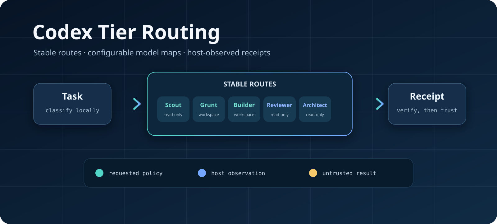

<div align="center">

# codex-tier-routing

**Stable Codex task routes, configurable model/effort mappings, and host-observed receipts.**

[](LICENSE)
[](CHANGELOG.md)
[](docs/compatibility.md)

</div>



<p align="center">
Original project by <a href="https://github.com/0xTitanas">0xTitanas</a> ·
<a href="https://github.com/0xTitanas/codex-tier-routing">Canonical repository</a>
</p>

`codex-tier-routing` installs five Codex agent profiles and a local dispatcher.
The profiles make task intent explicit. The dispatcher adds the part a profile
cannot provide on its own: a host-observed receipt that records the model,
effort, sandbox, approval policy, working directory, and child session seen in
the Codex rollout.

This is an independent community project. It is not an OpenAI product and is
not endorsed by or affiliated with OpenAI. It uses documented Codex CLI and
configuration behavior, but its rollout parsing and compatibility assertions
remain this project's responsibility.

The current release candidate is `v1.0.0-rc.1`. It is feature-complete within
the documented compatibility boundary and is prepared for clean-runner and
independent-install validation before the stable `v1.0.0` tag.

The project does not prove provider-side model identity, measure cost or
quality improvements, or make delegated output trustworthy by itself. The
parent still has to inspect the result. The default model IDs follow the current
[OpenAI model catalog](https://developers.openai.com/api/docs/models); users
must have access to each configured model.

## Routes

| Route | Default model | Default effort | Fixed sandbox | Typical use |
|---|---|---|---|---|
| `scout` | `gpt-5.6-luna` | low | read-only | Search, dependency surveys, documentation lookup |
| `grunt` | `gpt-5.6-luna` | low | workspace-write | Formatting, boilerplate, mechanical edits |
| `builder` | `gpt-5.6-terra` | medium | workspace-write | Scoped features, fixes, tests, and refactors |
| `reviewer` | `gpt-5.6-terra` | high | read-only | Correctness, security, and coverage review |
| `architect` | `gpt-5.6-sol` | xhigh | read-only | Difficult design decisions |

These defaults work without a policy file. An owner may change only the model
and effort mapping through one validated TOML file. Route names, sandbox modes,
network posture, approval policy, and concurrency limits remain fixed in code.

## How it works

```text
Task
  -> choose one stable route
  -> load and validate the active model/effort policy
  -> run codex exec with fixed authority boundaries
  -> read the host-written rollout
  -> compare requested and observed fields
  -> append a private local receipt
  -> return output and receipt to the parent
```

The dispatcher refuses to run while native generic subagent spawning is enabled.
Strict mode disables that path in the selected Codex home, then verifies the
effective feature state before a routed child starts.

## Requirements

- Python 3.11 or newer
- An installed Codex CLI with `codex exec`
- A working Codex login for that CLI
- Access to the configured model names
- macOS or Linux

See [compatibility](docs/compatibility.md) for the tested boundary.

## Check out the project safely

These commands inspect the repository and preview installation without changing
your Codex home:

```sh
python3 scripts/validate.py
python3 -m unittest discover -s tests -v
./install.sh --strict --dry-run
```

## Install

Review the installer and preview its changes first. Then install into your Codex
home:

```sh
./install.sh --strict
```

The installer copies:

- `agents/*.toml` to `$CODEX_HOME/agents/`
- `skills/model-routing/` to `$CODEX_HOME/skills/model-routing/`
- `bin/codex-tier` and `bin/codex-tier.py` to `$CODEX_HOME/bin/`

If `CODEX_HOME` is unset, the installer uses `$HOME/.codex`. Existing files are
moved into an owner-only timestamped backup tree before replacement. The
installer prints an exact uninstall command for the files and strict
configuration it manages.

To exercise the complete install path without touching your normal Codex home:

```sh
export CODEX_HOME="$(python3 -c 'import os,tempfile; print(os.path.realpath(tempfile.mkdtemp()))')"
./install.sh --strict
"$CODEX_HOME/bin/codex-tier" probe
```

The temporary directory remains available for inspection after the commands
finish.

## Customize models and effort

Customization is optional. To start from the shipped defaults, install one
owner-only policy file from the repository:

```sh
POLICY_DIR="${CODEX_HOME:-$HOME/.codex}/tier-routing"
mkdir -p "$POLICY_DIR"
chmod 700 "$POLICY_DIR"
install -m 600 policy.sample.toml "$POLICY_DIR/policy.toml"
"${CODEX_HOME:-$HOME/.codex}/bin/codex-tier" policy-check
```

Edit only `model` and `effort` in
`${CODEX_HOME:-$HOME/.codex}/tier-routing/policy.toml`. The file must retain
all five routes and remain mode `0600`; its directory must remain mode `0700`.
`policy-check` is offline: it rejects unknown fields, unsafe model-ID syntax,
and unsupported effort values, then prints the fully resolved mapping and the
accepted effort list.

This release accepts `none`, `low`, `medium`, `high`, `xhigh`, and `max`, the
reasoning-effort set published for the default GPT-5.6 family. It intentionally
does not accept `minimal` or `ultra`. A syntactically valid model name is not
proof that the current account can use it or that a different model supports
the selected effort. Codex CLI 0.144.1 does not expose a trusted
account-entitlement list, so `policy-check` reports
`model_access: not_checked`. After each model or effort change, run one bounded
canary for every changed route. A failed canary HALTs; the dispatcher never
falls back to another model or retries automatically.

No subscription-plan detection, automatic downgrade, price/quality ranking, or
model-strength inference is performed. The operator owns the explicit mapping.

The custom file governs the receipt-bearing local dispatcher. The installed
agent profile files remain default role descriptions; they are not rewritten
when the policy changes and cannot independently support a custom-route claim.

## Dispatch a canary

Run a small read-only canary after installation and after material Codex CLI,
account, or model-access changes:

```sh
printf '%s\n' 'Reply exactly ROUTE_CANARY_OK. Do not inspect files.' | \
  "$CODEX_HOME/bin/codex-tier" dispatch \
  --route scout --workdir "$PWD"
```

A passing receipt shows what the local Codex host recorded for that child. It
does not prove that the provider served a particular model or that the returned
answer is correct.

## Commands

```text
codex-tier --version
codex-tier probe
codex-tier policy-check
codex-tier receipt-check [--receipt-file /absolute/envelope.json]
codex-tier strict-enable
codex-tier strict-disable
codex-tier dispatch --route ROUTE --workdir /absolute/project/path
```

`dispatch` reads the task from standard input. `--prompt-file` is also available
for an owner-controlled regular file. The command performs no automatic retry.

`receipt-check` performs an offline semantic check of one emitted envelope from
stdin or an owner-only file. It recomputes the effective-policy and output
bindings and checks status, route, observation, and sandbox invariants. It does
not replace validation against the published JSON Schemas, prove that the
receipt is retained in a ledger, or attest provider-side model identity.

## Security boundary

The installer and dispatcher:

- reject symlinked, cross-owner, and unsafe writable Codex-home paths;
- resolve the Codex executable from an absolute, owner-checked path;
- run installer filesystem utilities through the platform's system utility path;
- validate lexical and resolved Python interpreter paths before strict installation;
- start strict-mode Python processes with a minimal environment;
- launch the installed dispatcher through a hardened `/bin/sh` wrapper that
  clears loader and Python startup variables before resolving the interpreter;
- invoke script-based Codex entrypoints through an independently validated
  shebang runtime instead of allowing the kernel to resolve it again;
- bind launcher, dispatcher source, Python interpreter, Codex entrypoint, and
  Codex runtime paths and hashes into each receipt;
- check the complete path below the Codex home before reading rollout files;
- require owner-private state and ledger files;
- require an owner-only, exact-schema policy file and bind both its input hash
  and the complete effective policy into each receipt;
- run `codex exec --strict-config`, force workspace network off and extra
  writable roots empty at launch, and fail closed unless the host rollout uses
  Codex 0.144.1's canonical empty-root encoding; receipts normalize that
  verified omission to an explicit `writable_roots: []`;
- launch each child with approval policy `never` and verify the observed
  value afterward;
- kill the child process group on timeout or stream failure;
- record a halt instead of accepting missing or mismatched observations.

The Codex process receives an explicit environment containing the validated
home boundaries plus `PATH` and locale/terminal values. Arbitrary caller
variables and environment-only API credentials are not forwarded. This is
still not a credential-isolation boundary: Codex can use its normal saved login
state, and its session files contain task and output data.

The `read-only` and `workspace-write` labels describe the host-observed local
shell/filesystem sandbox. They do not attest provider behavior or make every
configured MCP server, plugin, connector, web-search tool, or other external
tool side-effect-free. Review the active Codex tool configuration separately.
A write-capable child may change its workspace before a later receipt mismatch
is detected. Use a clean worktree and inspect state after every ambiguous
outcome.

Read [SECURITY.md](SECURITY.md) and the
[local dispatcher guide](docs/local-dispatcher.md) before relying on strict mode.

## Limits

- Windows is not supported.
- Compatibility is bounded to the versions and platforms listed in
  [docs/compatibility.md](docs/compatibility.md).
- The ledger provides local self-consistency checks. An actor able to rewrite
  the complete file can re-chain, truncate, replace, or delete it; use an
  independently protected checkpoint if stronger retention evidence is needed.
- Strict mode governs sessions that use the same Codex home and configuration.
  Administrator-managed requirements are needed to prevent user or project
  overrides.
- No benchmark, cost reduction, reliability improvement, or provider-side
  attestation claim is made.
- Model-name syntax validation is not account-access validation. Use a bounded
  canary to test each configured mapping.
- The trust model excludes root, the current operating-system identity, and any
  identity able to write a trusted runtime ancestor. See the
  [threat model](docs/threat-model.md).

## Development

```sh
DEV_VENV="$(python3 -c 'import os,tempfile; print(os.path.realpath(tempfile.mkdtemp()))')/venv"
python3 -m venv "$DEV_VENV"
. "$DEV_VENV/bin/activate"
python -m pip install --upgrade pip
python -m pip install --disable-pip-version-check -r requirements-dev.txt
python scripts/validate.py
python -m unittest discover -s tests -v
sh -n install.sh
sh -n bin/codex-tier
PYTHONPYCACHEPREFIX=/tmp/codex-tier-pycache python -m py_compile \
  bin/codex-tier.py scripts/validate.py tests/test_codex_tier.py tests/test_installer.py
ruff check .
ruff format --check scripts tests bin/codex-tier.py
```

## Clean GitHub CI and release

GitHub CI tests only committed content. Before tagging `v1.0.0-rc.1`, push the
release branch, open a pull request into `main`, and require every `CI` job to
pass on GitHub-hosted runners. The workflow runs lint plus the macOS/Ubuntu
matrix for Python 3.11, 3.13, and 3.14; it performs no model calls.

With the optional GitHub CLI installed:

```sh
BRANCH="$(git branch --show-current)"
test -n "$BRANCH"
test "$BRANCH" != "main"
git push --set-upstream origin "$BRANCH"
gh pr create --fill --base main --head "$BRANCH"
gh pr checks --watch
```

Merge only after the required checks are green and the branch is current with
`main`. Tag the resulting `main` commit—not the pre-merge branch—and wait for
the tag-triggered CI run before creating a prerelease. See the complete,
copy-pasteable procedure in [docs/releasing.md](docs/releasing.md).

## Repository map

- [`agents/`](agents/): five Codex agent profiles
- [`bin/codex-tier`](bin/codex-tier): hardened POSIX launcher
- [`bin/codex-tier.py`](bin/codex-tier.py): local dispatcher runtime
- [`skills/model-routing/SKILL.md`](skills/model-routing/SKILL.md): routing policy
- [`schemas/local-dispatch-receipt.schema.json`](schemas/local-dispatch-receipt.schema.json): receipt contract
- [`schemas/local-dispatch-envelope.schema.json`](schemas/local-dispatch-envelope.schema.json): emitted envelope contract
- [`docs/local-dispatcher.md`](docs/local-dispatcher.md): detailed behavior and limits
- [`docs/compatibility.md`](docs/compatibility.md): tested compatibility boundary
- [`docs/threat-model.md`](docs/threat-model.md): security goals, trust anchors, and exclusions
- [`policy.sample.toml`](policy.sample.toml): optional single-file model/effort customization
- [`VERSION`](VERSION): canonical project version
- [`install.sh`](install.sh): transactional installer
- [`docs/releasing.md`](docs/releasing.md): clean-CI, tagging, and prerelease procedure
- [`scripts/validate.py`](scripts/validate.py): repository validator
- [`tests/`](tests/): dispatcher and installer regression suite

## Contributing

See [CONTRIBUTING.md](CONTRIBUTING.md). Security issues belong in GitHub private
vulnerability reporting, not a public issue.

## Provenance

The original creator is [0xTitanas](https://github.com/0xTitanas). The canonical
source is
[`0xTitanas/codex-tier-routing`](https://github.com/0xTitanas/codex-tier-routing).
Reuse does not imply endorsement.

- License: [MIT](LICENSE)
- Notice: [NOTICE.md](NOTICE.md)
- Citation metadata: [CITATION.cff](CITATION.cff)
